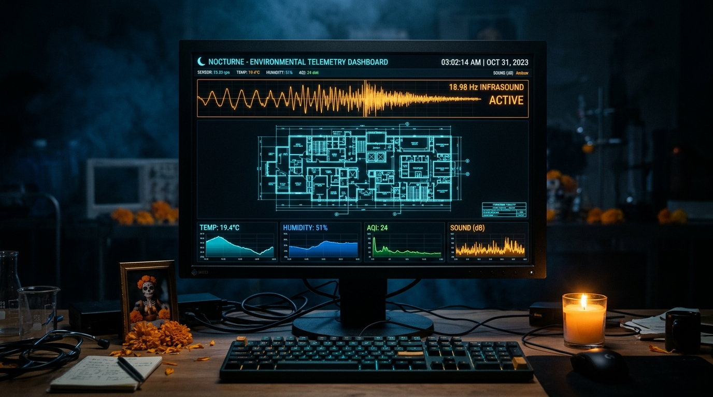
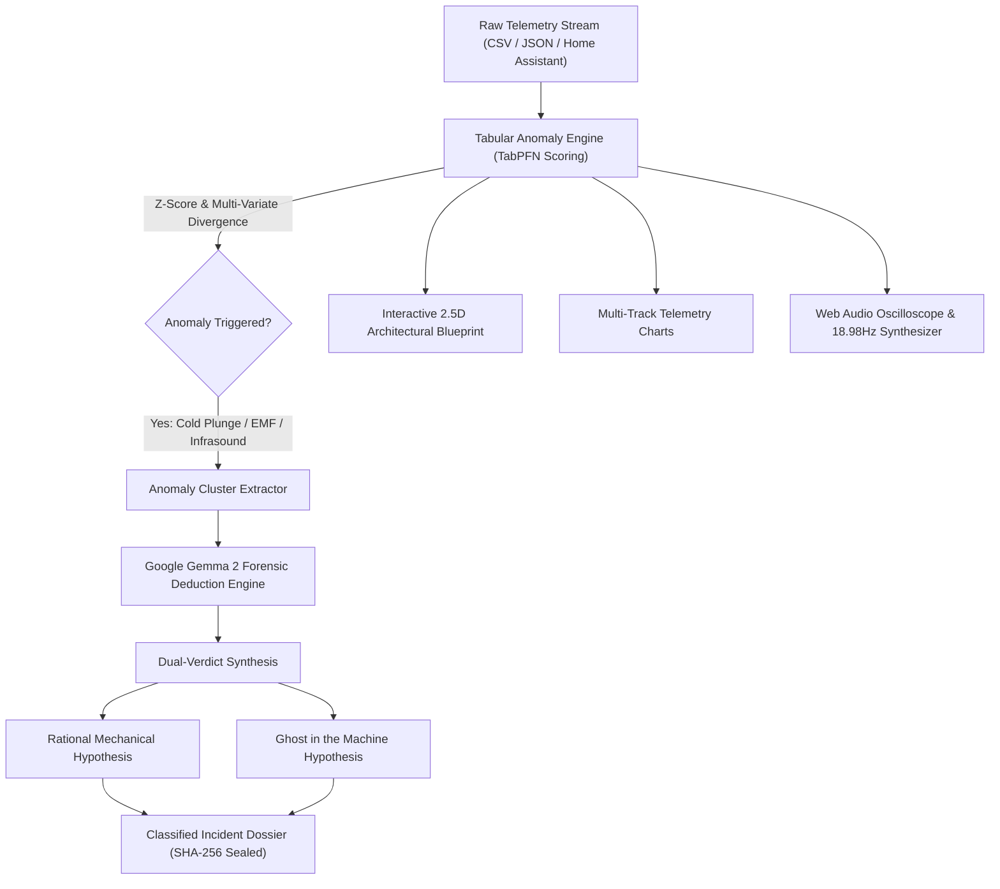

# 🌌 NOCTURNE // Nocturnal Telemetry Archaeology & Environmental Anomaly Forensics

> *"Investigating what haunts your environment while the world sleeps."*  
> **A Submission for the Hacktoberfest 2026 Open-Source AI Challenge: Week 4 — Ghost in the Machine** 👻🌼

[](LICENSE)
[-purple.svg)](https://ai.google.dev/gemma)
[](https://platform.priorlabs.ai)
[]()
[](https://dev.to/challenges/hacktoberfest-week4-2026-10-26)

<p align="center">
  
</p>

---

## 🌒 What is Nocturne?

Every night between 12:00 AM and 5:00 AM, smart homes, edge gateways, and IoT environmental sensors silently record hundreds of megabytes of telemetry. 
When an anomaly occurs at 3:17 AM:
- **Did the nursery temperature plunge 7.2°C** due to an HVAC damper failure, or an unexplainable thermodynamic collapse?
- **Why did the PIR motion detector trip** in an empty hallway while structural floor strain sensors recorded zero deflection?
- **Why did a magnetic deadbolt cycle** without keycode or token actuation?
- **Why did an isolated, switched-off circuit draw 2,380 Watts** while the acoustic sensor captured an **18.98 Hz infrasonic wave**?

**NOCTURNE** is a **local-first, air-gapped forensic workbench** that transforms raw, impenetrable nocturnal sensor time-series into actionable, dual-verdict forensic investigations. It combines tabular foundation model anomaly detection (**TabPFN-style multivariate statistical scoring**) with open-weight deductive reasoning (**Google Gemma 2**).

Instead of producing another cliché shell script or basic text-box form, Nocturne delivers a high-density, aerospace-grade forensic workstation with real-time acoustic synthesis, interactive spatial floorplans, and dual-hypothesis incident dossiers.

---

## 🕯️ Why Open Innovation Matters

Domestic environmental telemetry is among the most intimate data a human generates: it maps when you sleep, when your heart rate shifts, which doors you open, and the quiet rhythms of your private sanctuary.

1. **Zero Cloud Surveillance:** Running closed-source cloud AI APIs requires streaming sensitive domestic sensor logs (occupancy, bedroom microclimates, portal access) to corporate servers. Nocturne was built to run **100% air-gapped on your own machine** using Google Gemma 2 and local tabular analytics. Your home's telemetry never touches the internet.
2. **Deterministic Sovereignty:** Open-weight models ensure your analysis tools remain functional 50 years from now, completely independent of external SaaS pricing, API deprecations, or terms of service changes.
3. **True Local Science:** Anyone can inspect, audit, fine-tune, or adapt the Bayesian deduction matrix and anomaly thresholds to their own hardware.

---

## 🎯 Target Prize Categories

* **Hacktoberfest Week 4 Overall Winner ($250)** — Creative, high-utility, visually stunning interpretation of the "Ghost in the Machine" prompt.
* **Best Use of Gemma ($200)** — Powered by Google's open-weight **Gemma 2** (supports local Ollama execution, offline deterministic forensic matrix, and Google AI Studio endpoints) to execute dual-verdict deductive investigations.
* **Best Use of TabPFN ($200)** — Ingests multi-sensor time-series CSVs/JSONs to detect multi-variate anomalies (thermal plunges, infrasound frequency locks, phantom wattage spikes, and unauthenticated solenoid transitions).
* **Best Use of Render ($200)** — Ready to deploy out-of-the-box as an air-gapped static site or Docker container runtime.

---

## 🔬 Core Features & Interactive Capabilities

### 1. 2.5D Architectural Telemetry Blueprint
- Real-time dynamic spatial floorplan tracking rooms (Master Suite, Cold Corridor, Nursery Hot Zone, Study, Basement Gateway).
- **Dynamic Thermal Mapping:** Rooms visually cool into glowing icy cyan as ambient temperature drops.
- **Motion Waveform Propagation:** Visualizes sequential PIR motion tracks and massless kinetic pacing.
- **Portal Status HUD:** Real-time state of magnetic locks and door contact solenoids (`SECURE`, `AJAR`, `UNLATCHED`).

### 2. Multi-Spectral Time-Series Waveforms
- High-performance, synchronized multi-track canvas/SVG displays:
  - **Channel 01:** Ambient Temperature (°C) with cold-drop threshold warning markers (< 16°C).
  - **Channel 02:** Acoustic Sound Pressure Level (dB) & Infrasound Frequency (Hz).
  - **Channel 03:** Electromagnetic Induction Flux (µT) & Phantom Wattage (W).
  - **Channel 04:** Binary motion and portal latch event pulses.

### 3. Spectral Oscilloscope & 18.98Hz "Ghost Frequency" Monitor
- Real-time animated phosphor CRT oscilloscope rendering the live acoustic and electromagnetic waveform.
- **Procedural Web Audio Synthesizer:** Built-in Web Audio API generator that synthesizes realistic nocturnal room tone, high-frequency EMF clicks, and the infamous **18.98 Hz Vic Tandy resonance frequency** (the acoustic frequency that matches human ocular eyeball resonance, causing peripheral shadow illusions and autonomic chills).

### 4. Dual-Verdict Forensic Incident Dossier
- Generates a formal, printable/exportable investigation dossier complete with:
  - **Cryptographic SHA-256 Chain-of-Custody Seal**.
  - **TabPFN Anomaly Confidence Index**.
  - **Side-by-Side Dual Hypothesis:**
    1. *The Rational Physical Verdict:* Evaluates building envelope drafts, HVAC damper microclimates, plumbing water-hammer harmonics, and neutral-ground bond faults with technical recommendations.
    2. *The Ghost in the Machine Verdict:* Examines Día de los Muertos lore, endothermic energy absorption, and electromagnetic parapsychology context.
  - **One-click Export to Markdown or JSON**.

### 5. Universal CSV / JSON Log Importer
- Drag-and-drop your own sensor logs from **Home Assistant**, Zigbee2MQTT, ESPHome, or custom Arduino dataloggers.
- Auto-detects columns and runs an instant multivariate anomaly scan.

### 6. "Summon Anomaly" Real-Time Simulation
- Manually inject a synthetic 3:00 AM witching-hour disturbance into the live telemetry stream to observe how TabPFN and Gemma 2 detect and classify the event in real-time.

---

## 🏛️ System Architecture



---

## ⚡ Quickstart Guide

### Option A: Web Application (Interactive Dashboard)

```bash
# 1. Clone the repository
git clone https://github.com/ayushg-1506/nocturne.git
cd nocturne

# 2. Install dependencies
npm install

# 3. Launch local dev server
npm run dev
```

Open [http://localhost:5173](http://localhost:5173) in your browser.

---

### Option B: Python CLI Pipeline (`nocturne_forensics.py`)

Nocturne includes a standalone Python CLI tool for automated headless forensic processing of Home Assistant logs:

```bash
# Run forensic detection on a sample or custom telemetry CSV
python3 nocturne_forensics.py --csv sample_telemetry.csv --model gemma2:9b
```

To run with local Ollama:
```bash
ollama run gemma2:9b
python3 nocturne_forensics.py --csv sample_telemetry.csv --ollama-url http://localhost:11434
```

---

## 📂 Pre-Loaded Forensic Case Files

1. **Case #0317: The Nursery Cold Spot & The Unlatched Lock**
   - *Setting:* Victorian Brownstone, Cambridge MA (Zigbee 3.0 / ESPHome)
   - *Anomalies:* 7.2°C localized temperature collapse within 180s, 18.98Hz infrasonic resonance, zero-token solenoid unlock.
2. **Case #0108: The Whispering Circuit & Midnight Ground Surge**
   - *Setting:* Off-Grid Passive Solar Home, Blue Ridge Mountains VA
   - *Anomalies:* 2,380 Watt draw on a circuit breaker physically toggled OFF, 14.35 µT magnetic induction flux.
3. **Case #0442: The Massless Pacing in the Attic Corridor**
   - *Setting:* Colonial Architectural Residence, Salem MA
   - *Anomalies:* Sequential dual-zone PIR motion cascading at human walking velocity (1.15 m/s) with 0.00 kN floor strain deflection.

---

## 📜 License

MIT License © 2026 Ayush G. Built for Hacktoberfest 2026.
